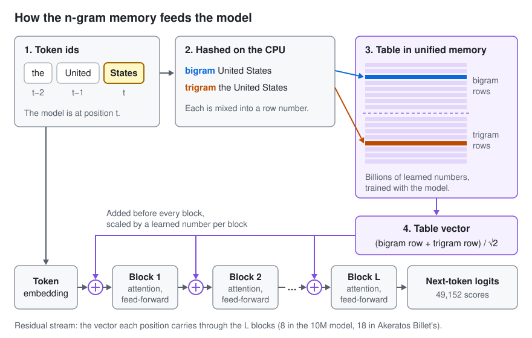

# The n-gram memory

Akeratos's models carry a large learned table of vectors, one row per hashed pair or triple of neighbouring tokens.

The code is in [`akeratos/table/`](https://github.com/cogvera-labs/akeratos/tree/main/akeratos/table).

## The idea

An *n-gram* is a run of n neighbouring tokens. "New York" is a bigram (n = 2); "the United States" is a trigram (n = 3). Classic language models before neural networks were n-gram counters: they predicted the next word from how often each short run had followed another in the training text.

Akeratos's version is learned: each bigram and trigram gets a vector the length of the model's residual stream, trained with the rest of the model. At every position, the model reads two rows (the bigram ending at this token, and the trigram ending at this token) and adds their sum, divided by √2, into the residual stream before every layer.

Why bother? A transformer's layers have to rebuild short, frequent patterns ("of the", "United States", the next digit of a date) from scratch at every position. A table can hand them over in one lookup, so the layers can spend their capacity on longer-range context.

Others have built similar tables. [Engram](https://arxiv.org/abs/2601.07372) and the [Over-Tokenized Transformer](https://arxiv.org/abs/2501.16975) hash n-grams into embedding tables; [DeepSeek-V4.1-Flash](https://huggingface.co/deepseek-ai/DeepSeek-V4.1-Flash) ships 196 billion parameters of Engram memory, and [Qwen3.8-Flash-Next](https://arxiv.org/abs/2608.30320) keeps 51 billion parameters of n-gram tables in host memory. The modded-nanogpt speedrun added a hashed bigram table in [record 62](https://github.com/KellerJordan/modded-nanogpt/tree/master/records/track_1_short/2026-01-19_BigramHashEmbedding) and an 84.6-million-row table in [record 92](https://github.com/KellerJordan/modded-nanogpt/tree/master/records/track_1_short/2026-08-30_ANVIL2). [SCONE](https://arxiv.org/abs/2502.01637) learns embeddings for frequent n-grams with a separate model instead of hashing, and [COUNT](https://arxiv.org/abs/2610.20456) keeps n-gram counts, not learned rows, in host memory. Akeratos's question is whether the trade pays off for small models trained on a single Mac, where memory is plentiful and compute is the limit. That is why every headline run has a *twin*: the same model, trained on the same tokens, with the table off.

## Finding a row: hashing

There are far more possible bigrams and trigrams (49,152² and 49,152³) than any table can hold, so rows are found by *hashing*. The token ids of the n-gram are mixed into one large number by a fixed recipe of multiplications and bit shifts, and the remainder after dividing by the number of rows picks the row. Half the rows belong to bigrams and half to trigrams.

Different n-grams sometimes share a row (a *collision*). With millions of rows, frequent n-grams rarely collide with each other, and rare ones that share a row each get a slightly blurred vector. The hash is seeded, and the seed is saved with the checkpoint, so a trained table always reads back the same way.

At the start of a document, the missing earlier positions are filled with a padding value that is not a real token, so a bigram never reaches back into the previous document.

The hashing runs on the CPU in NumPy, before the batch goes to the GPU.

## How the rows learn

Every row starts at zero, so at first the table adds nothing and the model behaves like a plain transformer.

The model's dense weights train with AdamW, which keeps two extra numbers per weight, updated at every step; for a table of billions of entries that would cost several times the table's own memory and time. So the table has its own rule, a sparse version of Adam:

- Only the rows read in this step are updated. They are gathered into a small *working set*, which the model reads instead of the full table, so the gradient is only as large as the working set; after the dense update, each is written back to its shard before the next step's rows are gathered.
- Each row keeps one running average of its squared gradient, one number per row rather than per entry, plus the step at which it was last updated.
- When a row is read again after many steps asleep, its running average is first decayed as if it had been updated with zero gradient in between (*replay*). The result matches updating that row at every step to within 3 parts in 10 million, in tests where rows slept for up to 389 updates.
- The table's learning rate is a fixed multiple of the embedding's, and never falls below 30% of its peak after warm-up, so rarely seen rows still learn late in training.

## Storing billions of numbers

Billet's table has 6.0 billion numbers: 7,812,500 rows of 768. Stored at 16 bits (*bfloat16*), with the per-row extras, that is 12.1 GB.

Rounding a small update to 16 bits would often round it away entirely. So each write-back uses *stochastic rounding*: it rounds up or down at random, with probabilities chosen so that the expected value is exact. An 8-bit row format, with one scale per row, is a switch.

The table is split into *shards*, separate arrays of at most 2²⁹ (about 537 million) numbers each in Billet and never more than about 2 billion, because MLX 0.32.3, which Billet trained on, can return a wrong sum or maximum over more than 2³¹ (about 2.1 billion) elements. MLX 0.32.4 fixes this but not a related bug; [MLX notes](../mlx-notes.md) lists both. One object, the shard store, owns every shard and never hands one out. If anything kept a reference to a shard while it was written, the framework would silently copy the whole shard, and a surprise 1 GB copy mid-step can push a Mac past the memory it planned for; a check after each write fails the step at once if a shard was copied.

## What the table costs

- **Memory, not compute.** Reading two rows per token is cheap; holding the table is not ([Training on a Mac](apple-silicon.md)).
- **Shipped size.** Billet ships its table as trained, at 16 bits: 12.1 GB.

What the table is worth is measured, not assumed: the [open problems](https://github.com/cogvera-labs/akeratos/blob/main/OPEN_PROBLEMS.md) list what is still unanswered.
